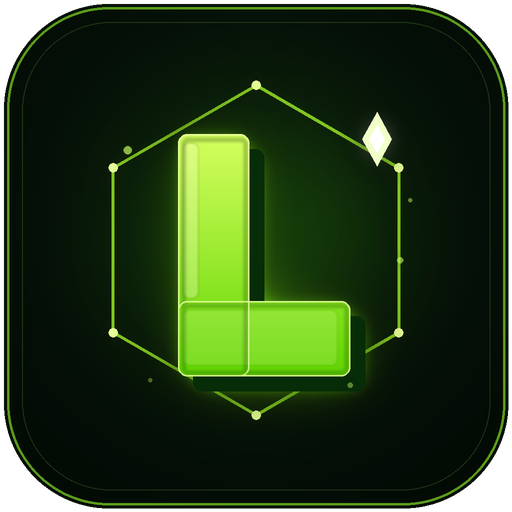

<div align="center">



# ⭐ Lumina Engine

**A full 2D game studio that lives on your Android phone.**
Visual blocks, a real code editor, an AI assistant and GitHub sync, powered by LibGDX + Box2D.

<br>

<a href="https://github.com/AssassinGhostYT/Lumina-Engine/releases/latest">
  
</a>

<br><br>

[](https://github.com/AssassinGhostYT/Lumina-Engine/actions/workflows/android-build.yml)


</div>

---

## 📥 Where do I download the app?

> **Option 1 — direct download:** **[LuminaEngine-0.5.1Beta.apk](https://github.com/AssassinGhostYT/Lumina-Engine/releases/download/v0.5.1Beta/LuminaEngine-0.5.1Beta.apk)** (97 MB, debug-signed, installs on any phone).
>
> **Option 2 — Releases page:** open the [latest release](https://github.com/AssassinGhostYT/Lumina-Engine/releases/latest) and download the `.apk` from **Assets**.
>
> **Option 3 — the robot builds it:** every push to `main` runs **Actions → Build APK**. Open the latest green run, scroll to **Artifacts** and download **LuminaEngine-apk**.
>
> On Android you will need to allow installation from your browser/file manager the first time.
>
> You do **not** need a computer to try the engine. The source in this page is for developers who want to read, build or contribute.

**Checksum (SHA-256):** `1f2aa901fdcc6b0b786360e845bfc157483226fef7411a3a4d72178e771bf977`

| I want to... | Go to |
|---|---|
| Install and use the engine | **[Latest APK from CI](https://github.com/AssassinGhostYT/Lumina-Engine/actions/workflows/android-build.yml)** or [Releases](https://github.com/AssassinGhostYT/Lumina-Engine/releases/latest) |
| Build it myself | [Build from source](#-build-from-source) |
| Use my own AI / OpenCode | [AI guide](docs/AI.md) |
| Fix a bug or add a feature | [Contributing](#-contributing) |

---

## ✨ What is Lumina Engine?

Lumina Engine is an **open-source 2D game engine and editor that runs entirely on a phone**.
You design scenes, wire up gameplay with blocks or Java, run the game, and export an APK, all without a computer.

Under the hood it is **LibGDX** for rendering and **Box2D** for physics, with a native Android editor on top.

---

## 🚀 Feature list

- **Editor:** scenes, elements, Bodies list, files manager, undo/redo, safe-area aware layouts for portrait and landscape.
- **Visual scripting:** event-driven blocks (touch, step, collisions...), nested blocks, search, custom blocks.
- **Code editor:** Java with syntax highlighting, auto-complete, error panel, copy all errors.
- **Physics:** Box2D bodies, joints, sensors, custom collider and road editor, lights (point / cone / directional).
- **Behaviors:** 56 built-in, configurable through script variables.
- **UI tools:** UI Maker, Button Maker, themes, UI holders.
- **Assets:** 1,831-icon browser with search and color filter, free asset packs, animation editor, fonts.
- **Structure:** Groups, Prefabs (edit one, apply to all), multiple scenes, Y-sort.
- **AI:** built-in assistant (Pollinations keyless, OpenRouter, Gemini, OpenCode Zen) and a remote MCP connector for Claude or OpenCode. See [docs/AI.md](docs/AI.md) and [server/README.md](server/README.md).
- **Git:** clone, commit, push, and GitHub Actions workflows added to your game project. See [docs/CI.md](docs/CI.md).
- **Export:** produce an APK from the phone; experimental desktop export ([docs/DESKTOP.md](docs/DESKTOP.md)).
- **Languages:** English, Arabic, French, Portuguese, Russian, Spanish.

---

## 🧩 Project layout

| Path | What it is |
|---|---|
| `app/` | The Android editor (this is the APK you install) |
| `template/` | The game runtime used by exported games (generated template, see [docs/TEMPLATE.md](docs/TEMPLATE.md)) |
| `desktop/` | Experimental desktop runtime |
| `formatter/` | Code formatter used by the code editor |
| `server/` | AI / Remote connector server ([README](server/README.md)) |
| `tools/` | Build, template and i18n helper scripts |
| `docs/` | Behaviors, UI, script variables, CI, AI and template docs |

---

## 🛠 Build from source

Requirements: **JDK 21** and the **Android SDK** (Android Studio works).

```bash
git clone https://github.com/AssassinGhostYT/Lumina-Engine.git
cd Lumina-Engine
chmod +x gradlew
./gradlew :app:assembleDebug
# APK: app/build/outputs/apk/debug/app-debug.apk
```

This debug build installs on any phone and needs no signing setup. To build a **release-signed** APK you need your own keystore (or the `KEYSTORE_FILE`, `KEYSTORE_PASSWORD`, `KEY_ALIAS` environment variables) and then run `./gradlew :app:assembleRelease`.

---

## 🤖 Automated APK builds

The **Build APK** workflow (`.github/workflows/android-build.yml`) runs on every push to `main`, on pull requests and manually:

1. Open **Actions → Build APK**.
2. Click the latest run.
3. Download **LuminaEngine-apk** from **Artifacts**.

The CI APK is **debug-signed**: it installs normally, but it cannot update an APK signed with another key. For a release-signed APK, use the *Aab & Apk Build* workflow with these repository secrets:

| Secret | What it is |
|---|---|
| `KEYSTORE_BASE64` | your `.jks` file encoded with `base64 -w0` |
| `KEYSTORE_PASSWORD` | keystore password |
| `KEY_ALIAS` | key alias inside the keystore |
| `KEY_PASSWORD` | key password (optional, defaults to the keystore password) |

The *Aab & Apk Build* workflow can also upload to Google Play (production, beta, alpha or draft) and publish to GitHub Releases when those secrets plus `PLAY_STORE_JSON_KEY` are configured.

> If you change the game runtime, regenerate the template (`:template` module + the *Build game template* action) and never edit `template.zip` by hand.

---

## 🤝 Contributing

Contributions of every size are welcome:

- Fix bugs or improve performance
- Add behaviors, UI styles or sample games
- Translate strings (`app/src/main/assets/i18n/`, check with `python3 tools/i18n/dump_keys.py --check`)
- Write docs and tutorials

Open an issue first for big changes. Pull requests should keep Android Java compatibility and run the i18n check.

---

## 💖 Support the project

Lumina Engine is free and open source. If it helps you, star ⭐ the repo, share it, or open an issue to report bugs and suggest features.

---

## 🌐 Community

[GitHub Repository](https://github.com/AssassinGhostYT/Lumina-Engine) · [Issues](https://github.com/AssassinGhostYT/Lumina-Engine/issues) · [Releases](https://github.com/AssassinGhostYT/Lumina-Engine/releases/latest) · [CI builds](https://github.com/AssassinGhostYT/Lumina-Engine/actions/workflows/android-build.yml)

---

## 🇸🇦 بالعربية

**Lumina Engine** محرك ألعاب ثنائية الأبعاد مفتوح المصدر يعمل بالكامل على هاتف أندرويد: بلوكات، محرر أكواد، 56 سلوكًا جاهزًا، صانع واجهات وأزرار، 1,831 أيقونة، مساعد ذكاء اصطناعي، ومزامنة مع GitHub.

> **تحميل التطبيق:** من [Releases](https://github.com/AssassinGhostYT/Lumina-Engine/releases/latest)، أو من **Actions ← Build APK ← آخر تشغيل ← Artifacts ← LuminaEngine-apk**.

---

> [!NOTE]
> You are free to use and modify this project under the Apache-2.0 license. See [LICENSE](LICENSE) and [assets/note.txt](assets/note.txt).

> [!CAUTION]
> Some bugs may still exist. Reports and fixes are highly appreciated. 🚒
